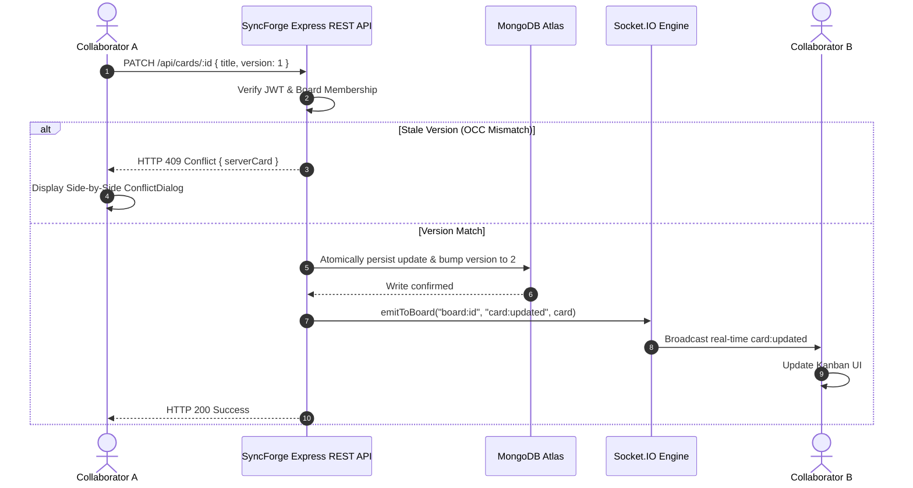

# SyncForge — Real-Time Collaborative Project Workspace

SyncForge is an industry-oriented full-stack collaborative project management platform built on the MERN stack (MongoDB, Express, React, Node.js) with real-time WebSocket synchronization via Socket.IO, fractional-position list and task ordering, and Optimistic Concurrency Control (OCC).

---

## Key Capabilities

- **Real-Time Event Delivery ("Commit-Then-Broadcast"):** State mutations are committed to MongoDB Atlas before emitting scoped events via Socket.IO rooms (`board:<id>`), ensuring collaborators receive only authoritative updates.
- **Fractional Indexing ($O(1)$ Reordering):** Lists and cards calculate midpoints between neighboring items (`(before + after) / 2`). Moving an item requires exactly 1 document write with zero sibling re-indexing.
- **Optimistic Concurrency Control (OCC):** Cards track a monotonic integer `version`. Concurrent edits trigger an `HTTP 409 Conflict` response with side-by-side visual diff comparison, allowing users to choose "Keep Collaborator's Version" or "Overwrite With Mine".
- **Three-Tier Role-Based Access Control (RBAC):**
  - **Owner:** Full workspace administration, member invitations, role management, and board deletion.
  - **Member:** Create, edit, reorder, and delete task cards and lists.
  - **Viewer (Read-Only):** Observes board state, searches/filters, and receives live WebSocket broadcasts without mutation permissions.
- **Collaborator Management:** Dedicated UI to invite users by email, assign roles, inspect team memberships, and manage permissions.
- **Activity Stream:** Append-only timeline with cursor pagination tracking who created, edited, moved, or deleted boards, lists, and cards.
- **Cloud Media Storage:** Native Cloudinary integration for profile avatars and file attachments.

---

## Architectural Highlights



---

## Technology Stack

| Layer | Technologies |
| :--- | :--- |
| **Frontend** | React 18, Vite 5, Tailwind CSS, `@dnd-kit` (Core & Sortable), Socket.IO Client, Axios, React Router 6, Lucide Icons |
| **Backend** | Node.js, Express 4, Socket.IO 4, Mongoose 8, Zod, Helmet, Cookie-Parser, CORS, Express-Rate-Limit, BCryptJS, JSONWebToken |
| **Database** | MongoDB Atlas (Production & Integration Testing) |
| **Cloud Storage** | Cloudinary |
| **Testing** | Jest 29, Supertest 7, MongoMemoryServer 10 |
| **Deployment** | Render Blueprint (`render.yaml`), Node.js Web Service |

---

## Project Structure

```
syncforge/
├── client/                     # Vite + React web application
│   ├── src/
│   │   ├── api/                # Axios HTTP client with credentials
│   │   ├── components/         # SortableCard, ListColumn, CardModal, ConflictDialog, MemberModal
│   │   ├── context/            # AuthContext (session state & bootstrap)
│   │   ├── pages/              # BoardsList, BoardView, Login, Register
│   │   ├── socket.js           # Socket.IO connection manager
│   │   └── theme.js            # Priority tag and label color palettes
│   └── vite.config.js          # Vite config with API proxy
├── server/                     # Express & Socket.IO backend service
│   ├── src/
│   │   ├── config/             # MongoDB Atlas, Cloudinary & Env configuration
│   │   ├── controllers/        # Auth, Board, List, and Card controllers
│   │   ├── middleware/         # Auth, RBAC boardAccess, rateLimit, errorHandler
│   │   ├── models/             # User, Board, List, Card (OCC), Activity schemas
│   │   ├── routes/             # REST endpoints (/api/auth, /api/boards, etc.)
│   │   ├── sockets/            # JWT handshake auth & room join authorization
│   │   └── utils/              # Fractional position math, token issuance, activity logger
│   └── tests/                  # Jest integration test suite (12 test assertions)
├── render.yaml                 # Infrastructure-as-code Render blueprint
└── package.json                # npm workspaces root
```

---

## Getting Started

### 1. Prerequisites
- Node.js >= 18.0.0
- npm >= 9.0.0
- MongoDB Atlas cluster connection string

### 2. Environment Variables
Create `.env` inside `server/` (or copy `.env.example` at root):

```env
PORT=5000
NODE_ENV=development
CLIENT_ORIGIN=http://localhost:5173

# Database (MongoDB Atlas)
MONGO_URI=mongodb+srv://<username>:<password>@cluster0.zibm66x.mongodb.net/SyncForge_db?retryWrites=true&w=majority

# Authentication
JWT_SECRET=syncforge_super_secure_jwt_secret_token_key_2026_at_least_32_chars
JWT_EXPIRES_IN=7d

# Cloudinary
CLOUDINARY_CLOUD_NAME=cblqllb4
CLOUDINARY_API_KEY=395367419741642
CLOUDINARY_API_SECRET=1SG9xf-6HZKzVgQu3Im-nFKuFZ4
CLOUDINARY_FOLDER=mern_stack_project_storage/SyncForge_storage
```

### 3. Installation
From the root workspace directory:

```bash
npm install
```

### 4. Running the Development Servers
Run both backend API (port 5000) and frontend Vite client (port 5173) concurrently:

```bash
npm run dev
```

### 5. Running the Test Suite
Execute the integration test suite (verifying Auth, Board RBAC, $O(1)$ fractional positioning, and OCC 409 conflict handling):

```bash
npm test
```

---

## Deployment (Render)

This project contains a verified `render.yaml` blueprint. To deploy to Render:

1. Push this repository to your GitHub account (`https://github.com/karthikeyantoff/SyncForge`).
2. Log in to [Render](https://dashboard.render.com).
3. Click **New +** -> **Blueprint**.
4. Select your `SyncForge` repository.
5. Provide your `MONGO_URI` Atlas connection string when prompted.
6. Render will automatically install dependencies, build the React client, and start the unified Express + Socket.IO web service.

---

## Author & License

- **Architect & Engineer:** Karthikeyan T (`karthikeyantoff@gmail.com`)
- **License:** MIT License
