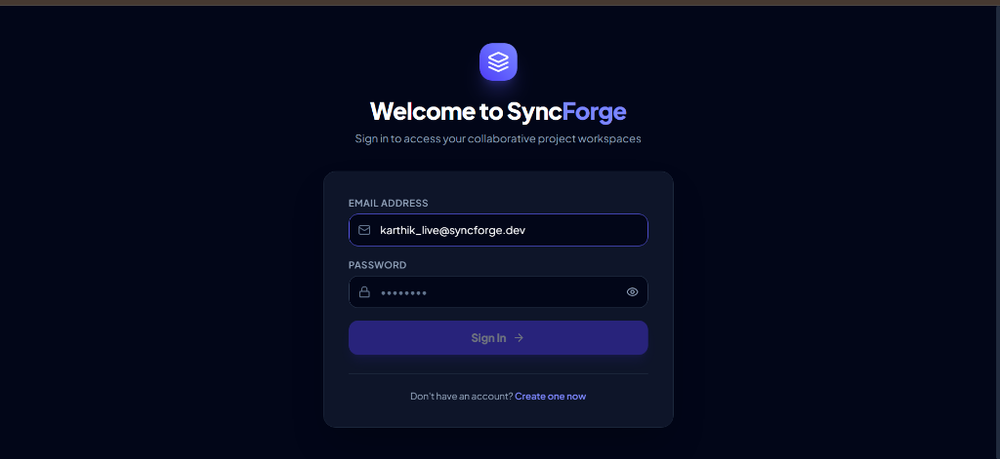
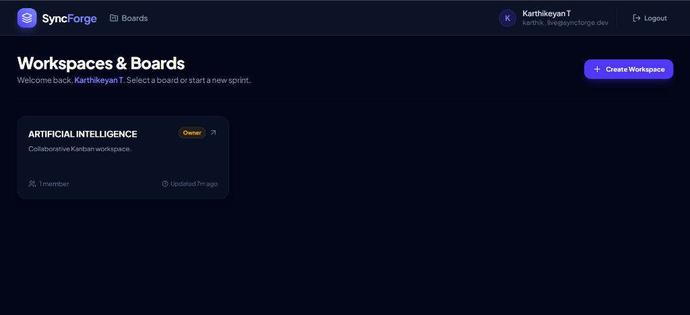
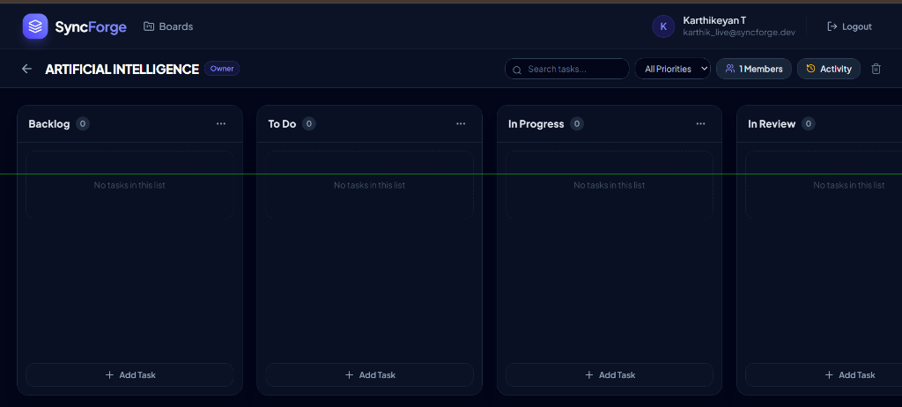
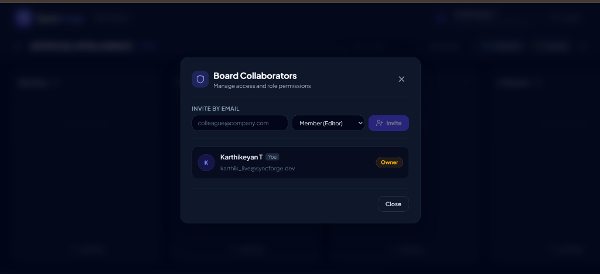
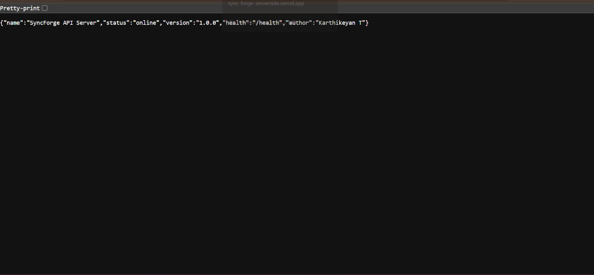
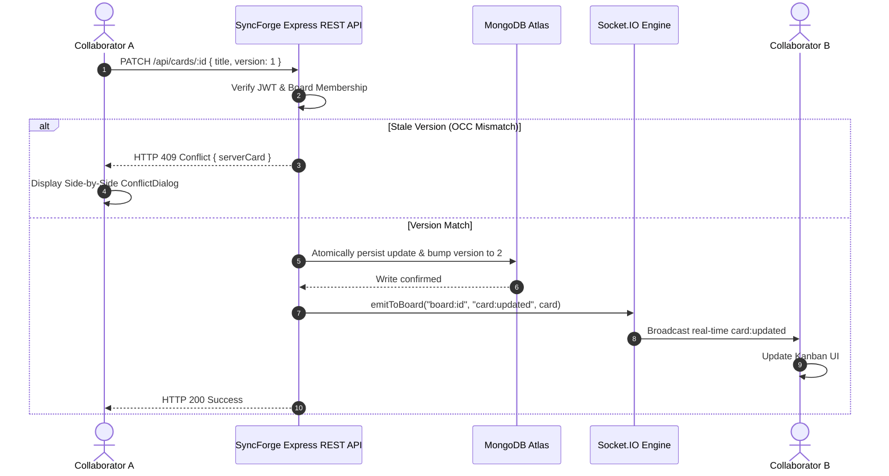

# SyncForge — Real-Time Collaborative Project Workspace

> **A modern, high-concurrency project management platform engineered with the MERN stack, Socket.IO real-time bi-directional events, $O(1)$ fractional positioning, Cloudinary CDN attachments, and Optimistic Concurrency Control (OCC).**

---

### 🌐 Live Production Deployments

| Component | Platform | Live URL | Status |
| :--- | :---: | :--- | :---: |
| **Client Application (Frontend)** | Vercel | [https://syncforge-client.vercel.app/](https://syncforge-client.vercel.app/) |  |
| **API Server & WebSockets (Backend)** | Vercel | [https://sync-forge-serverside.vercel.app/](https://sync-forge-serverside.vercel.app/) |  |
| **System Health Check** | Vercel API | [https://sync-forge-serverside.vercel.app/health](https://sync-forge-serverside.vercel.app/health) |  |

---

### 👨‍💻 Author & Forward Deployed Engineer

- **Engineer:** **Karthikeyan T**
- **Email:** [karthikeyantoff@gmail.com](mailto:karthikeyantoff@gmail.com)
- **GitHub Profile:** [@karthikeyantoff](https://github.com/karthikeyantoff)
- **Repository:** [karthikeyantoff/-SyncForge](https://github.com/karthikeyantoff/-SyncForge.git)

---

## Key Capabilities

- **Real-Time Event Delivery ("Commit-Then-Broadcast"):** State mutations are committed to MongoDB Atlas before emitting scoped events via Socket.IO rooms (`board:<id>`), ensuring collaborators receive only authoritative updates.
- **Fractional Indexing ($O(1)$ Reordering):** Lists and cards calculate midpoints between neighboring items (`(before + after) / 2`). Moving an item requires exactly 1 document write with zero sibling re-indexing.
- **Optimistic Concurrency Control (OCC):** Cards track a monotonic integer `version`. Concurrent edits trigger an `HTTP 409 Conflict` response with side-by-side visual diff comparison, allowing users to choose "Keep Collaborator's Version" or "Overwrite With Mine".
- **Three-Tier Role-Based Access Control (RBAC):**
  - **Owner:** Full workspace administration, member invitations, role management, and board deletion.
  - **Member:** Create, edit, reorder, and delete task cards and lists.
  - **Viewer (Read-Only):** Observes board state, searches/filters, and receives live WebSocket broadcasts without mutation permissions.
- **Collaborator Management:** Dedicated UI to invite users by email, assign roles, inspect team memberships, and manage permissions.
- **Activity Stream:** Append-only timeline with cursor pagination tracking who created, edited, moved, or deleted boards, lists, and cards.
- **Cloud Media Storage:** Native Cloudinary integration for profile avatars and file attachments.

---

## 📸 Production Application Preview

### 1. Secure Authentication & Verification Portal

*Modern dark-mode authentication with RFC-compliant email validation, JWT session security, and dynamic password checklist.*

### 2. Workspace & Multi-Board Dashboard

*Centralized management hub displaying all active workspaces, collaborator counts, ownership badges, and one-click board creation.*

### 3. Real-Time Kanban Workspace ($O(1)$ Drag-and-Drop)

*High-concurrency sprint board featuring dynamic multi-column workflows (`Backlog`, `To Do`, `In Progress`, `In Review`), @dnd-kit drag-and-drop, and sub-50ms Socket.IO real-time synchronization.*

### 4. Role-Based Access Control (RBAC) & Collaborator Management

*Granular permission control modal allowing Workspace Owners to invite teammates via email and assign Member (editor) or Viewer (read-only) roles.*

### 5. Live Serverless API Health & Author Verification

*Authoritative Vercel serverless backend health endpoint confirming live database connectivity, versioning, and Forward Deployed Engineer verification.*

---



---

## Technology Stack

| Layer | Technologies |
| :--- | :--- |
| **Frontend** | React 18, Vite 5, Tailwind CSS, `@dnd-kit` (Core & Sortable), Socket.IO Client, Axios, React Router 6, Lucide Icons |
| **Backend** | Node.js, Express 4, Socket.IO 4, Mongoose 8, Zod, Helmet, Cookie-Parser, CORS, Express-Rate-Limit, BCryptJS, JSONWebToken |
| **Database** | MongoDB Atlas (Production & Integration Testing) |
| **Cloud Storage** | Cloudinary |
| **Testing** | Jest 29, Supertest 7, MongoMemoryServer 10 |
| **Deployment** | Render Blueprint (`render.yaml`), Node.js Web Service |

---

## Project Structure

```
syncforge/
├── client/                     # Vite + React web application
│   ├── src/
│   │   ├── api/                # Axios HTTP client with credentials
│   │   ├── components/         # SortableCard, ListColumn, CardModal, ConflictDialog, MemberModal
│   │   ├── context/            # AuthContext (session state & bootstrap)
│   │   ├── pages/              # BoardsList, BoardView, Login, Register
│   │   ├── socket.js           # Socket.IO connection manager
│   │   └── theme.js            # Priority tag and label color palettes
│   └── vite.config.js          # Vite config with API proxy
├── server/                     # Express & Socket.IO backend service
│   ├── src/
│   │   ├── config/             # MongoDB Atlas, Cloudinary & Env configuration
│   │   ├── controllers/        # Auth, Board, List, and Card controllers
│   │   ├── middleware/         # Auth, RBAC boardAccess, rateLimit, errorHandler
│   │   ├── models/             # User, Board, List, Card (OCC), Activity schemas
│   │   ├── routes/             # REST endpoints (/api/auth, /api/boards, etc.)
│   │   ├── sockets/            # JWT handshake auth & room join authorization
│   │   └── utils/              # Fractional position math, token issuance, activity logger
│   └── tests/                  # Jest integration test suite (12 test assertions)
├── render.yaml                 # Infrastructure-as-code Render blueprint
└── package.json                # npm workspaces root
```

---

## Getting Started

### 1. Prerequisites
- Node.js >= 18.0.0
- npm >= 9.0.0
- MongoDB Atlas cluster connection string

### 2. Environment Variables
Create `.env` inside `server/` (or copy `.env.example` at root):

```env
PORT=5000
NODE_ENV=development
CLIENT_ORIGIN=http://localhost:5173

# Database (MongoDB Atlas)
MONGO_URI=mongodb+srv://<username>:<password>@cluster0.zibm66x.mongodb.net/SyncForge_db?retryWrites=true&w=majority

# Authentication
JWT_SECRET=syncforge_super_secure_jwt_secret_token_key_2026_at_least_32_chars
JWT_EXPIRES_IN=7d

# Cloudinary
CLOUDINARY_CLOUD_NAME=cblqllb4
CLOUDINARY_API_KEY=395367419741642
CLOUDINARY_API_SECRET=1SG9xf-6HZKzVgQu3Im-nFKuFZ4
CLOUDINARY_FOLDER=mern_stack_project_storage/SyncForge_storage
```

### 3. Installation
From the root workspace directory:

```bash
npm install
```

### 4. Running the Development Servers
Run both backend API (port 5000) and frontend Vite client (port 5173) concurrently:

```bash
npm run dev
```

### 5. Running the Test Suite
Execute the integration test suite (verifying Auth, Board RBAC, $O(1)$ fractional positioning, and OCC 409 conflict handling):

```bash
npm test
```

---

## Deployment Architecture (Vercel & Render)

### Vercel Production Deployment (Live)
- **Frontend SPA:** Deployed on Vercel at [https://syncforge-client.vercel.app/](https://syncforge-client.vercel.app/). Includes reverse proxy configuration in `client/vercel.json` to seamlessly route `/api/*` and WebSocket handshakes directly to the serverless backend.
- **Backend Service:** Deployed on Vercel at [https://sync-forge-serverside.vercel.app/](https://sync-forge-serverside.vercel.app/) connecting directly to MongoDB Atlas cluster `cluster0.zibm66x.mongodb.net/SyncForge_db` and Cloudinary storage.

### Render Blueprint Deployment (Optional)
This repository also contains a verified `render.yaml` infrastructure-as-code blueprint:
1. Connect this repository to your [Render Dashboard](https://dashboard.render.com).
2. Click **New +** -> **Blueprint** and select `karthikeyantoff/-SyncForge`.
3. Provide your `MONGO_URI` Atlas connection string when prompted.
4. Render automatically runs `npm install`, builds the React client, and boots the unified Express & Socket.IO web service.

---

## Author & Forward Deployed Engineer

- **Author & Forward Deployed Engineer:** **Karthikeyan T**
- **Email:** [karthikeyantoff@gmail.com](mailto:karthikeyantoff@gmail.com)
- **GitHub:** [@karthikeyantoff](https://github.com/karthikeyantoff)
- **Project Repository:** [https://github.com/karthikeyantoff/-SyncForge.git](https://github.com/karthikeyantoff/-SyncForge.git)
- **Live Client Application:** [https://syncforge-client.vercel.app/](https://syncforge-client.vercel.app/)
- **Live Server API:** [https://sync-forge-serverside.vercel.app/](https://sync-forge-serverside.vercel.app/)
- **License:** MIT License
